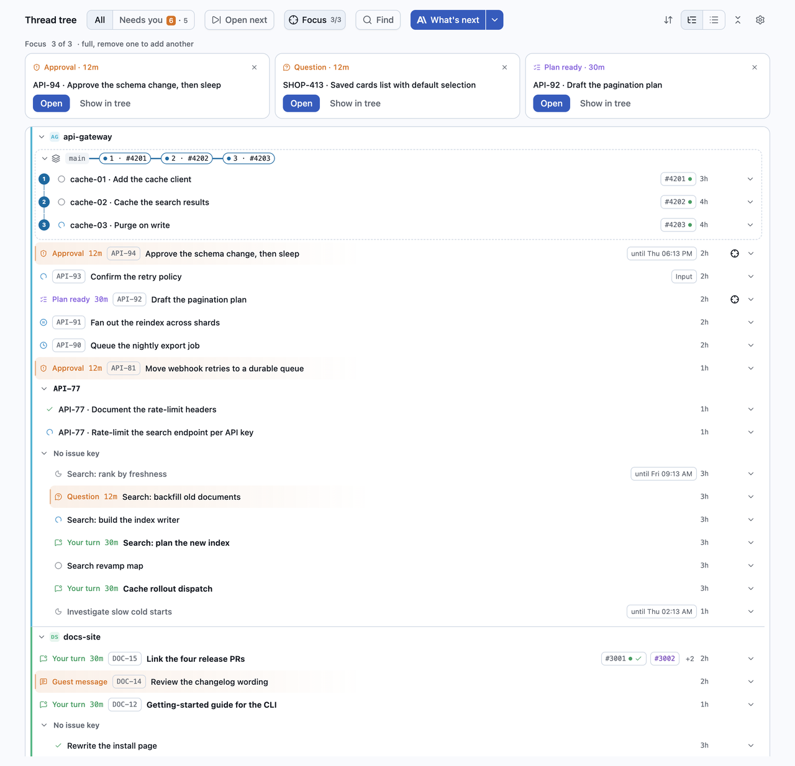

<p align="center"></p>

# T3 thread tree

A live map of your [T3 Code](https://github.com/pingdotgg/t3code) threads.

T3 Code shows threads as a flat list. When agents launch threads, review PRs and work through PR stacks, a flat list does not tell you how the work fits together. This app shows the active threads as one tree, **Project › issue key › thread**, with a status and the PR marks on each row. Click a thread to open it in T3 Code.

Use it as a Mac app or in a browser. The Mac app adds a Dock badge, notifications and a menu-bar entry for the threads that need you.




_Screenshots use made-up data from `bun run demo`._

## What you get

- **All projects in one list.** Each project is a block with its name on one header line above its threads, so you see all projects at once. Long thread titles wrap and are never cut, also on a phone. The project has the same icon and color as in T3 Code: two letters on a colored square, and the block has a left edge in that color. Hover the name to see the repository (`owner/name`). Threads group by the first issue key in the title (`SHOP-412`, `API-81`, …). A key group with one thread folds into its row, which shows the key as a chip. Review threads (`Review #…`) go in their own Reviews group. This group always sits at the top of the project, with an eye icon and a teal label, so you find it fast.
- **Header stays in view.** The header stays at the top of the window, and only the list below it scrolls. The header line of the project you scroll through stays at the top of the list.
- **Launch lineage.** The details block of a thread that an agent launched shows "Launched by" with a link to the thread that launched it. Turn on "Nest launched threads" in the "View" panel to show a launched thread with no issue key under that thread instead of in "No issue key". It is off by default. A thread in a PR stack stays in its stack. T3 does not store this link, so the app reads it from T3's local database.
- **PR stacks.** Issue groups that share a stack sit together in one block. Its header is a line from the base branch to the top PR, with one stop for each PR, for example `main ─ 1 · #2101 ─ 2 · #2102`. Click a stop to open the PR. Below the header, the threads sit on a numbered line, one number for each stack position. A red stop means failing checks, a conflict or requested changes, green means approved, grey means draft and blue means open. When the tree does not show all PRs of a stack, for example under a filter, each stop shows its position in the whole stack, such as `2 of 4 · #2102`. Click the chevron to fold the block to its header.
- **PR marks.** Each row shows its first two PRs. A PR chip shows checks (dot or ring), review (check or cross), conflicts (warning), draft (dashed border), merged (violet) and closed (struck through).
- **Your own order.** Drag the handle on the left edge of a project, group or thread row to move it in its list (only in "Manual" sort; the Flat view has its own order), or use Space and the arrow keys. The handle shows when the pointer is on the row. A row moves out of the way as soon as the dragged row enters it a little, also when the row is tall. A PR stack moves as one block. The order stays after a reload, and "Reset order" clears it.
- **Sort by last updated.** The sort button in the header opens a menu: "Manual" or "Last updated". "Last updated" puts the thread with the newest run start or run end first. Subthreads count for their parent. Projects keep their order. Reviews stays first and "No issue key" stays last. A PR stack moves as one block. Subthreads keep their order. Drag is off. When a run starts or ends, the rows slide to their new place. With reduced motion, they move at once. The choice stays after a reload.
- **Open next.** The "Open next" button in the header opens in T3 Code the thread that has waited longest: a thread that needs input, has a plan ready or waits for your turn, settled threads left out, subthreads included. Press it again to open the next thread. After all threads were opened, it starts again at the top. A thread that starts a new wait is a target again. The key `n` does the same, but not while you type in a field or while a dialog, a menu or the "View" panel is open. The tooltip shows the status, the title and the Wait of the target. When nothing waits, the button is disabled. At phone width, the button shows its icon only. In the Mac app, the menu-bar menu starts with "Open next · <title>", which opens the same thread.
- **Flat view.** The Tree and Flat buttons in the header switch the layout. Flat shows all threads of all projects in one list.
  - "Group by Status" sections fold. "Idle and snoozed" and "Done" start closed. A closed section keeps its count.
  - Drag works with "Manual" sort. The flat list has its own order, apart from the tree. With "Group by", a row moves only inside its group. In the Needs input, Plan ready and Your turn groups, rows do not drag.
  - Each row shows the project icon and name, and the issue key as a chip. On a phone, the project shows as an icon only. Each row and PR stack has a left edge in the project color, as in the tree.
  - A review thread has a teal eye before its title.
  - A subthread sits under its parent. A PR stack stays one block.
  - "Last updated" sorts across all projects. "Manual" starts as the tree order.
  - The "Needs you" filter and "show settled" work as in the tree.
  - The tree keeps its folds when you switch back.
  - The rows slide when the layout changes. The choice stays after a reload.
- **Group by status.** In the flat view, the "Group by" button groups the list by status. It is the same header button as "Fold all", and its icon morphs when you switch the view. Each group has a header with the count of its matching threads, subthreads included and settled threads left out. A thread that does not match its group shows muted. In a PR stack, those threads fold behind a "+N other threads" button. The order is: Needs input, Plan ready, Your turn, Failed, Working, "Idle and snoozed", Done. A group with no thread is hidden. A thread or a PR stack goes to the group of its most urgent thread, subthreads included, settled threads left out. Needs input, Plan ready and Your turn show the longest wait first. A thread slides to a new group when its status changes. The choice stays after a reload.
- **Stable order.** Rows keep their place while threads update. A new thread, group or project shows at the bottom of its list.
- **Status changes move.** A new status icon or PR mark fades in. The row flashes once in the new status color. With reduced motion, changes show at once.
- **Rows come and go.** A new project, group or thread grows in. A removed one collapses out. A change that arrives during a drag shows at once. With reduced motion, rows appear and disappear at once.
- **Fold all at once.** In the tree, the button in the header closes or opens all projects, groups and PR stacks. A project or group row with groups or PR stacks in it has its own button at its end (shown on hover): it closes all rows in it, or opens the row and all rows in it. The icon morphs between the two arrow pairs.
- **Folds slide.** A project, group, PR stack or details panel slides open and shut, and its chevron turns. With reduced motion, it opens and shuts at once.
- **Status at a glance.** Each row starts with one status icon, so the issue key and title start close to it. Each kind of status has its own icon: for example, a shield for an approval, a question bubble for a question, and a chat bubble with a dot for "your turn" (a result you did not open yet). Rows that wait on you show the phrase and the wait beside the icon, for example "Approval 12m", "Plan ready 30m" or "Your turn 30m". A failed row shows "Failed". Hover the icon to see the phrase and the elapsed time, for example "Working 12m". The details show when the thread was last updated. The "View" panel has a legend of all icons. Color is never the only sign.

  | Color                | Statuses                                                            |
  | -------------------- | ------------------------------------------------------------------- |
  | amber, edge breathes | needs input: approval, question, sign-in or guest message           |
  | blue                 | working (icon turns), starting or queued, waiting on another thread |
  | violet               | plan ready                                                          |
  | green                | your turn (bold title), done                                        |
  | red                  | failed, interrupted or cancelled                                    |
  | grey                 | idle, or snoozed (title muted, with the wake time)                  |

- **What needs you.** The "Needs you" filter in the header shows how many threads need you. A muted number next to it counts the your-turn threads. A tooltip names both counts. "Needs you" keeps only the threads with needs input, plan ready or your turn. The browser tab title shows the count of threads with needs input or plan ready, for example "(5) Thread tree". Settled threads do not count, as with the Dock badge. When the count is not 0, the tab icon gets an amber dot.
- **Details on demand.** The chevron at the end of a row opens a details block: request, error, the end of the last message, usage limit, model, branch, worktree, launched by, goal, tags and all PRs with their checks and size.
- **View and settings panel.** The "View" button in the header opens a panel on the right. The tree stays visible next to it, so you see each change at once. Escape or the close button closes it. Each field tells you what to type and where to find it.
  - **Updates.** In the desktop app, this group comes first. It shows the app version and the update state. The panel checks for a new version each time it opens, but not more than once in 60 s. A button updates the app in place and shows the progress.
  - **View.** Rows that stay open: show settled threads, nest launched threads, reset the drag-and-drop order, and the theme (Light, System or Dark, as icons).
  - **Setup.** Folds that stay closed until you open them. Each fold shows its state at the right: green text when it is set, yellow text with a warning sign when it is not set.
    - **T3 token.** A password field for the token, with the command that issues one. Paste a new token at any time to replace it. The app saves it and reconnects, with no restart. When the token is missing or T3 rejects it, a banner shows with a link that opens the panel with this fold open.
    - **Linear links.** Type your Linear workspace, and issue keys link to their issue. Add team keys to link only the keys of those teams.
    - **Status icons.** A legend of all icons, shown with a blue info icon.
- **Live.** Changes arrive as T3 streams them. No polling, no reload.
- **The page remembers your choices.** Closed projects and groups (they show one status icon per thread, and an amber wash with a breathing edge when a hidden thread needs input or has a plan ready), the filter, "show settled", "show snoozed", the folds of the flat sections and the theme stay after a reload.
- **Settled threads on demand.** The "Show settled threads" switch in the "View" panel adds them. Archived threads never show.
- **Snoozed threads on demand.** The "Show snoozed threads" switch in the "View" panel hides snoozed threads. A snoozed thread with a visible subthread stays, muted. The Needs-you count does not change.
- **What's next.** A click on "What's next" shows a ranked list of next steps over the active threads, each with links to its threads. Code makes the obvious steps at once: answer a waiting agent, fix a PR with failing checks, conflicts or requested changes, and merge an approved PR. A local `claude` or `codex` CLI on a cheap model ranks the rest, and it does not run when nothing is left. A step can have a prompt that you copy with one click. It also has a send icon that opens a dialog with a thread picker, the end of the last message of the picked thread, and the editable prompt. When the picked thread waits for an approval, the dialog shows the same approval note. "Confirm send" sends the message to the thread, and the step then shows "Sent to" with the thread name. The send icon is off when no `t3` CLI is found. A step with a prompt also has a "Start thread" icon. It opens a dialog with a project picker, a title (the issue key and the step title), and the editable prompt. "Start thread" starts a new thread in that project with the prompt as its first message, and the thread then shows in the tree. This icon is also off when no `t3` CLI is found. The chevron next to the button opens a menu that selects the model. Each option shows its provider icon. The current model shows next to the button. At phone width, the button shows its icon only, and the model menu and name are hidden. A thread that is no longer active shows struck through.
- **Send from a row.** Each thread row, top-level or subthread, has a send icon at its end. It shows on hover or focus, and always on touch screens. It opens the same dialog with that thread as the fixed target and an empty message. The dialog shows the end of the last message of the target thread. When the thread waits for an approval, a note says that a message does not approve the request. The icon is off when no `t3` CLI is found. The row status changes when the thread takes the message.
- **Dock badge.** In the desktop app, the Dock icon shows how many threads need you (needs input or plan ready), the same count as the Needs-you badge in the header. Settled threads do not count, so with "show settled" on, the badge can be lower than the filter count. It updates with the window hidden, and it does not clear when you open the window.
- **Notifications.** In the desktop app, you get a notification when a thread starts to need input, has a plan ready or fails. When 3 or more threads change at once, you get one notification, "N threads need you". A click on a thread notification opens the thread in T3 Code. A click on the summary shows the window. A new notification for a thread replaces the earlier one. Nothing is sent for the threads that already need you when the app starts, or for settled threads. "Mute Notifications" in the app menu turns them off. The badge stays on.
- **Menu-bar entry.** The menu-bar icon shows the Needs-you count, and shows no number at 0. Its menu starts with "Open next · <title>" when a thread waits, then lists up to 10 threads, longest wait first. A click on a thread opens it in T3 Code. "+N more…" and "Open tree" show the window. "Mute Notifications" is the same switch as in the app menu. When a newer release exists, "Update available: vX.Y.Z…" shows below it, and a click offers the update. The label shows the stage while an update installs. "Quit" quits the app.
- **Desktop window.** The tree runs in its own macOS window, which you start from Spotlight or the Dock. The app starts the server for you. Closing the window hides it, and the tree keeps running. A click on the Dock icon shows it again, and Cmd-Q quits. The window opens at its last size and place. Links to T3 Code and to PRs open outside the window.
- **Updates.** The Mac app checks GitHub Releases at start and every 6 hours. When a newer release exists, the app menu and the menu-bar menu show "Update available: vX.Y.Z…", and the "View" button has a dot. Until then, both menus show "Check for Updates…". A click on the menu item checks now and shows the result in a dialog. The "View" panel shows the same state and has an "Update and restart" button. The update downloads, unpacks and puts the new version in place of the installed app, then opens it. The panel shows each stage and the download percent. While it runs, the "View" button shows a progress ring, the Dock icon shows a progress bar during the download, and the menus show the stage, for example "Downloading Update… 42%". The new version then shows a dialog with what changed, from the release notes, and a button that opens the release page. If the app cannot update itself (for example, when it does not run from the Applications folder), the panel and the dialog offer the release page. After a failed update, the menus show "Update Failed: Open Release Page…".

## Requirements

- [Bun](https://bun.sh) 1.3 or later
- T3 Code running on the same machine (the app reads `~/.t3/userdata`)
- Optional, for the desktop app: macOS on Apple Silicon
- Optional, for "What's next": the `claude` or `codex` CLI, logged in

## Setup

```sh
bun install
```

Start the app, open the "View" panel and paste a T3 token in the "T3 token" field. The panel shows the command that issues one. The app keeps the token in `~/.config/t3-thread-tree/token`, and the desktop app in `~/Library/Application Support/T3 Thread Tree/token`. A `T3_TOKEN` in `.env` still works as the fallback when no token is saved.

Optional: link Linear issue keys. Set them in the page settings, or add these to `.env`. The page setting wins over `.env`.

```sh
LINEAR_WORKSPACE=join-com   # the slug in linear.app/<workspace>
LINEAR_TEAMS=JED,ENG,MOR    # optional: link only the keys of these teams
```

Optional: set the path of the `t3` CLI, which the app runs to send messages and start threads. Add this to `.env`. The default is `~/.t3/bin/t3`:

```sh
T3_BIN=/path/to/t3
```

### Install

Choose one path.

- **`.dmg`:** download the `.dmg` from GitHub Releases and drag the app to `/Applications`. The app has an ad-hoc signature, not a Developer ID. At the first open, macOS blocks it. Open System Settings › Privacy & Security and click "Open Anyway". Or run this command:

  ```sh
  xattr -dr com.apple.quarantine "/Applications/T3 Thread Tree.app"
  ```

- **From source:** run `bun run desktop:install`. It builds the server, bundles the app, signs it and copies it to `/Applications/T3 Thread Tree.app`. Quit the app first, because the command replaces it. Run `bun run desktop:dmg` to write the `.dmg` to `release/` instead.
- **Browser:** run `bun start`. See [Run](#run).

## Run

```sh
bun start
```

Open <http://127.0.0.1:4773>.

- The page is served at once. It shows "Connecting to T3…" until the first tree is ready.
- The app starts even when T3 is not running. It retries every 3 s. Until T3 is back, the page shows the last tree, greyed, with the time of the last update.
- If no token is saved or T3 rejects it, a banner links to the "T3 token" field.

To use the desktop window, run `bun run desktop`. It takes the first free port from 4773. It keeps its own data, so it runs beside the installed app. Run `bun run desktop:demo` to see the demo in the window. Closing the window hides it. Cmd-Q quits.

To see the UI without T3, run `bun run demo` and open <http://127.0.0.1:4774>. The demo uses a stub brief runner: set `BRIEF=failed`, `BRIEF=empty` or `BRIEF=rules` to see the other outcomes, `CLIS=0` to offer no CLI, `PUSH=1` to fake a live change every 3 seconds, `SEND=failed` to make a send fail, and `T3CLI=0` to show the `t3` CLI as missing.

## How it works

```
T3 Code ──WebSocket (orchestration.subscribeShell)──▶ Bun server ──SSE (/events)──▶ React page
statev2.sqlite (read-only) ──launch lineage──────────▶
```

- `src/server/t3.ts` holds the T3 stream: a small hand-written Effect RPC client with JSON frames, and a lenient decoder. T3's protocol is internal, so all protocol code stays in this one module.
- `src/server/lineage.ts` finds the spawner of a launched thread from the launch tool calls in `statev2.sqlite`, opened read-only. It also reads the last assistant message of each thread for the brief.
- `src/server/brief.ts` makes the next-step brief: the code-ranked steps, a compact text digest for the model, and the CLI run with its tools off. It serves `/brief/clis`, `/brief/run` and `/brief/cancel`, and pushes the brief state as the SSE `brief` event. `src/server/next-step-prompt.md` is the ranking guide for the model.
- `src/server/build-tree.ts` applies the tree rules: visibility, placement, stack order and the eleven statuses. It is a pure function, and `bun test` covers it.
- `src/server.ts` keeps the thread map. It builds the whole tree again on each change, and pushes it as JSON over Server-Sent Events.
- `src/page/` is a React, Tailwind and shadcn page, bundled by Bun's HTML imports (Tailwind runs through `bunfig.toml`). There is no Vite and no build step. The fold, the filter, the attention counts and the elapsed times run on the page (`attention.ts`, `format.ts`).
- [DESIGN-SPEC.md](DESIGN-SPEC.md) defines the visual design. [SPEC.md](SPEC.md) defines the tree rules, and [CONTEXT.md](CONTEXT.md) defines the terms.
- `src/shared/tree.ts` holds the `Tree` type that the server and the page share.

The app writes to T3 only when you confirm a send or a start in a dialog. It runs the `t3` CLI for that, with the T3 login. The stream token keeps the `orchestration:read` scope only, and the app opens the database read-only.

The desktop app is Electron. `src/desktop/main.ts` is the main process. It starts the compiled server (the sidecar) as a child process, waits until it answers, and loads the page in the window. A preload bridge gives the page the badge, notifications, the menu-bar entry and the update check. electron-builder packages the app with the sidecar in `Resources/server`. It signs the app ad-hoc, with the JIT entitlements that the sidecar needs.

## Develop

```sh
bun test           # tree rules, brief, lineage, attention counts, formats
bun run typecheck  # types
bun run lint       # oxlint
bun run fmt        # oxfmt, writes fixes
bun run check      # all of the above, as CI runs it
bun run build:sidecar  # compiles the server into dist/sidecar/server (macOS arm64)
bun run desktop:install  # builds and installs the app in /Applications (macOS arm64)
bun run desktop:dmg    # builds the .dmg in release/
```

CI runs `bun run check` and `bun run build:sidecar` on every pull request. A pull request merges only when it passes.

## Status

It shows the threads of the local T3 environment only. Its write actions are send a message and start a thread. It has no settle, snooze or interrupt.

A macOS desktop app, with a Dock badge, notifications and a menu-bar entry, installs from source with one command, or builds as a `.dmg`. [SPEC.md](SPEC.md) › "Desktop app" defines it.
