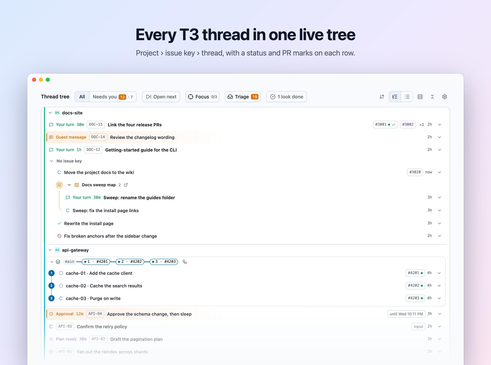
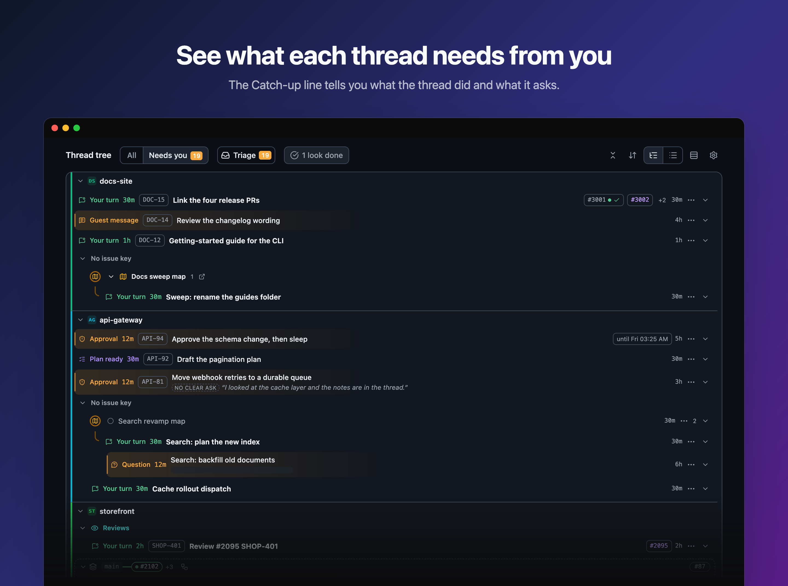
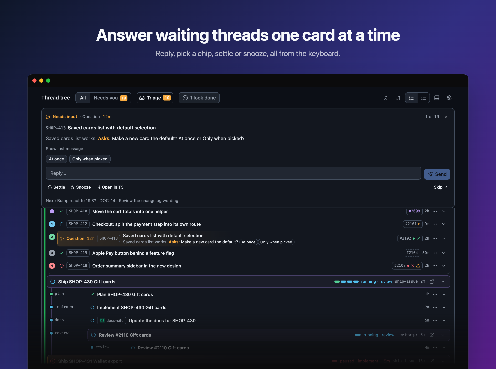

<p align="center"></p>

# T3 thread tree

A live map of your [T3 Code](https://github.com/pingdotgg/t3code) threads.

T3 Code shows threads as a flat list. When agents launch threads, review PRs and work through PR stacks, a flat list does not show how the work fits together. This app shows the active threads as one tree, **Project › issue key › thread**, with a status and PR marks on each row. Click a thread to open it in T3 Code.

Use it as a Mac app or in a browser. The Mac app adds a Dock badge, notifications, a menu-bar entry and a small Up next window.



## What you get

### See all your work in one tree

- **One tree for all projects.** Threads group by project, then by the first issue key in the title. Review threads go in a Reviews group at the top.
- **Status at a glance.** Each row starts with a status icon. Rows that wait for you show the wait time and a phrase, such as "Approval" or "Your turn".
- **PR marks and stacks.** Each row shows its PRs with checks, review, conflicts and merge marks. Threads in one PR stack sit in one block, with numbered stops from the base branch to the top PR.
- **Workflow runs.** An active T3 workflow run shows as a row with step pills. A rail under it lists each step with its thread.
- **Live.** Changes arrive as T3 streams them. No polling, no reload.

### Know what needs you



- **Catch-up line.** Under each waiting or failed row, a model writes what the thread did and what it asks, with the answer options as chips.
- **Needs you.** One filter keeps only the threads that wait for you. The browser tab title and the Dock badge show the count.
- **Open next.** The "Open next" button, or the key `n`, opens the thread that has waited longest.
- **Run questions and Paused runs.** A question from a T3 workflow, and a run that a failed step paused, also count as Needs you.
- **Triage mode.** The key `t` shows one card at a time for the waiting threads and runs. Reply, pick a chip, settle or snooze, each with one key. Answer a Run question, or resume or cancel a Paused run, from the same card.



### Also

- **Mac app:** Dock badge, notifications, a menu-bar entry and an Up next window (⌥⌘U) that stays on top.
- **Start a workflow:** type `>` in Cmd+K, or use the workflow button on a row, a PR stack or the Looks done list.
- **Suggested replies:** the send dialog offers reply chips, such as `commit push`, from the last agent message.
- **Looks done:** finds threads that look finished and settles them in one step, with undo.
- **Views:** Tree or Flat, group by T3 project, Linear project or status, and drag rows into your own order.
- **Find and keys:** Cmd+K searches all threads. Hold Alt/Option to see the keys next to the controls. Settings lists all keys.
- **Focus list:** pin up to three threads above the tree.

[SPEC.md](SPEC.md) gives the full rules for each feature.

## Requirements

- [Bun](https://bun.sh) 1.3 or later
- T3 Code running on the same machine (the app reads `~/.t3/userdata`)
- Optional, for the desktop app: macOS on Apple Silicon
- Optional, for the Catch-up: the `claude` or `codex` CLI, logged in
- Optional, for the Catch-up on a local model: the Ollama app build (`brew install --cask ollama-app`)
- Optional, for the Catch-up on the Apple model: the desktop app on macOS 26.4 or later, with Apple Intelligence on. To build the desktop app from source, Command Line Tools with the macOS 26.4 SDK or later

## Setup

```sh
bun install
```

Start the app, click the cog to open the Settings panel, and paste a T3 token in the "T3 token" field. The panel shows the command that issues one. The token needs the `orchestration:read` and `orchestration:operate` scopes. With a read-only token the tree works, but Settle fails. The app keeps the token in `~/.config/t3-thread-tree/token`, and the desktop app in `~/Library/Application Support/T3 Thread Tree/token`. A `T3_TOKEN` in `.env` works as the fallback. To fill the fields of a workflow, the app reads the workflow files. This needs the `filesystem:read` scope. Without it, Find still lists every workflow, and Settings says why the row menus are empty.

Optional: link Linear issue keys. Set them in Settings, or add these to `.env`. The Settings value wins.

```sh
LINEAR_WORKSPACE=join-com   # the slug in linear.app/<workspace>
LINEAR_TEAMS=JED,ENG,MOR    # optional: link only the keys of these teams
```

To group by Linear project and milestone, make a personal API key at `linear.app/settings/account/security` and paste it in the "Linear links" fold. A `LINEAR_API_KEY` in `.env` works as the fallback.

Optional: run the Catch-up on a local model. Install the Ollama app build with `brew install --cask ollama-app` (the Homebrew formula cannot return structured output). Pull a model, for example `ollama pull qwen3.5:4b-nvfp4`, and start Ollama. In the "Local model" fold, type the base URL (`http://localhost:11434/v1`) and the model name, and save. apfel (`brew install apfel`) also works here: base URL `http://localhost:11434/v1`, model `apple-foundationmodel`.

Optional: set the path of the `t3` CLI, which the app runs to send messages. The default is `~/.t3/bin/t3`:

```sh
T3_BIN=/path/to/t3
```

### Install

Choose one path.

- **`.dmg`:** download the `.dmg` from GitHub Releases and drag the app to `/Applications`. The app has an ad-hoc signature, not a Developer ID. At the first open, macOS blocks it. Open System Settings › Privacy & Security and click "Open Anyway". Or run this command:

  ```sh
  xattr -dr com.apple.quarantine "/Applications/T3 Thread Tree.app"
  ```

- **From source:** run `bun run desktop:install`. It builds and signs the app and copies it to `/Applications/T3 Thread Tree.app`. Quit the app first, because the command replaces it. Run `bun run desktop:dmg` to write the `.dmg` to `release/` instead.
- **Browser:** run `bun start`. See [Run](#run).

## Run

```sh
bun start
```

Open <http://127.0.0.1:4773>. The app starts even when T3 is not running. Until T3 is back, the page shows the last tree, greyed.

To use the desktop window from source, run `bun run desktop`. Run `bun run desktop:demo` to see the demo in the window.

To see the UI without T3, run `bun run demo` and open <http://127.0.0.1:4774>. Set `CLIS=0` to offer no CLI model, `PUSH=1` to fake a live change every 3 seconds, `SEND=failed` to make a send fail, and `T3CLI=0` to show the `t3` CLI as missing.

## How it works

```
T3 Code ──WebSocket (orchestration.subscribeShell)──▶ Bun server ──SSE (/events)──▶ React page
statev2.sqlite (read-only) ──launch lineage──────────▶
```

- `src/server/t3.ts` holds the T3 stream: a small Effect RPC client and a lenient decoder. T3's protocol is internal, so all protocol code stays in this one module.
- `src/server/lineage.ts` reads `statev2.sqlite`, read-only, for launch lineage and the last message of each thread.
- `src/server/model.ts` runs every model call, such as the Catch-up.
- `src/server/build-tree.ts` applies the tree rules. It is a pure function, and `bun test` covers it.
- `src/server.ts` builds the tree again on each change and pushes it over Server-Sent Events.
- `src/page/` is a React, Tailwind and shadcn page, bundled by Bun's HTML imports. There is no Vite and no build step.
- `src/shared/` holds the types and logic that the server and the page share.
- [SPEC.md](SPEC.md) defines the rules, [DESIGN-SPEC.md](DESIGN-SPEC.md) the visual design, and [CONTEXT.md](CONTEXT.md) the terms.

The app writes to T3 in two ways. A send or a workflow start runs the `t3` CLI. Settle, unsettle and snooze go over the stream, with the `orchestration:operate` scope of the token.

The desktop app is Electron. `src/desktop/main.ts` starts the compiled server as a child process and loads the page in the window. electron-builder packages and signs the app ad-hoc.

## Develop

```sh
bun test                 # unit tests
bun run typecheck        # types
bun run lint             # oxlint
bun run fmt              # oxfmt, writes fixes
bun run check            # all of the above, as CI runs it
bun run build:sidecar    # compiles the server (macOS arm64)
bun run build:apple-helper  # compiles the Apple model helper (macOS 26.4 SDK)
bun run desktop:install  # builds and installs the app in /Applications
bun run desktop:dmg      # builds the .dmg in release/
bun run release          # builds the .dmg and .zip and creates the GitHub release
bun run screenshots      # writes the framed README screenshots in docs/ from the demo data (needs Google Chrome)
```

CI runs `bun run check` and `bun run build:sidecar` on every pull request. A pull request merges only when it passes.
