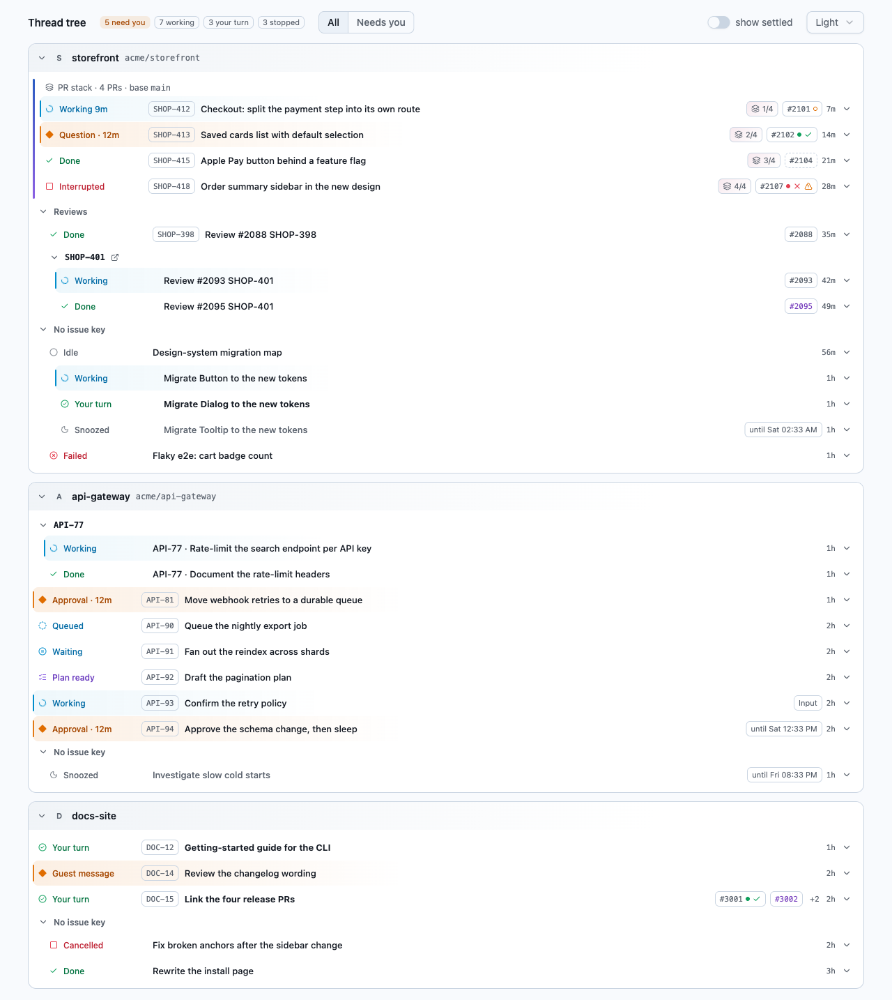
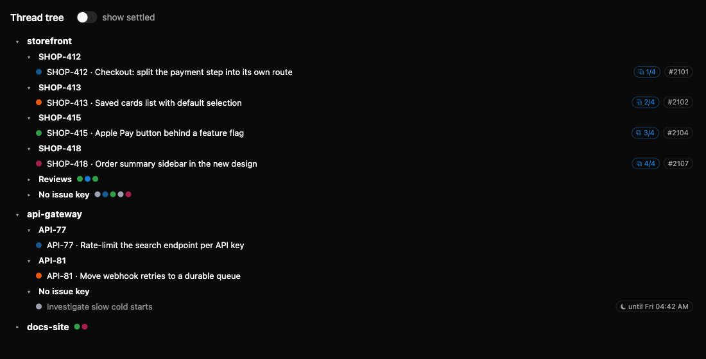

# T3 thread tree

A live, read-only map of your [T3 Code](https://github.com/pingdotgg/t3code) threads.

T3 Code shows threads as a flat list. When agents launch threads, review PRs and work through PR stacks, a flat list does not tell you how the work fits together. This app shows the active threads as one tree, **Project › issue key › thread**, with a status dot and the PR stack on each row. Click a thread to open it in T3 Code.





_Screenshots use made-up data from `bun run demo`._

## What you get

- **One tree for all projects.** Threads group by the first issue key in the title (`SHOP-412`, `API-81`, …). Review threads (`Review #…`) go in their own Reviews group.
- **Launch lineage.** A thread that an agent launched, with no issue key, nests under the thread that launched it. T3 does not store this link, so the app reads it from T3's local database.
- **PR stacks.** Each thread in a stack shows its position, for example `⧉ 2/4`. Issue groups that share a stack sit next to each other, in stack order.
- **Status at a glance.**

  | Dot | Means |
  |---|---|
  | orange | needs input: a pending question or approval |
  | blue, pulsing | running, queued or starting |
  | green | done, your turn |
  | red | cancelled, failed or interrupted |
  | grey | idle, or snoozed (title muted, with the wake time) |

- **Live.** Changes arrive as T3 streams them. No polling, no reload.
- **Closed groups stay closed.** A closed group shows one dot per thread. The page remembers which groups you closed.
- **Settled threads on demand.** The "show settled" toggle adds them. Archived threads never show.

## Requirements

- [Bun](https://bun.sh) 1.3 or later
- T3 Code running on the same machine (the app reads `~/.t3/userdata`)

## Setup

```sh
bun install
```

Issue a read-only token once, and put it in `.env` (gitignored):

```sh
echo "T3_TOKEN=$(~/.t3/bin/t3 auth session issue --scope orchestration:read --label thread-tree --ttl 52w --token-only)" > .env
```

Optional: link Linear issue keys. Add these to `.env`:

```sh
LINEAR_WORKSPACE=join-com   # the slug in linear.app/<workspace>
LINEAR_TEAMS=JED,ENG,MOR    # team keys that are Linear keys
```

## Run

```sh
bun start
```

Open <http://127.0.0.1:4773>.

- The app starts even when T3 is not running. It retries every 3 s. Until T3 is back, the page shows the last tree, greyed, with the time of the last update.
- If T3 rejects the token, the page shows the command to issue a new one.

To see the UI without T3, run `bun run demo` and open <http://127.0.0.1:4774>.

## How it works

```
T3 Code ──WebSocket (orchestration.subscribeShell)──▶ Bun server ──SSE (/events)──▶ React page
statev2.sqlite (read-only) ──launch lineage──────────▶
```

- `src/server/t3.ts` holds the T3 stream: a small hand-written Effect RPC client with JSON frames, and a lenient decoder. T3's protocol is internal, so all protocol code stays in this one module.
- `src/server/lineage.ts` finds the spawner of a launched thread from the launch tool calls in `statev2.sqlite`, opened read-only.
- `src/server/build-tree.ts` applies the tree rules: visibility, placement, stack order and status. It is a pure function, and `bun test` covers it.
- `src/server.ts` keeps the thread map. It builds the whole tree again on each change, and pushes it as JSON over Server-Sent Events.
- `src/page/` is a React, Tailwind and shadcn page, bundled by Bun's HTML imports (Tailwind runs through `bunfig.toml`). There is no Vite and no build step.
- `src/shared/tree.ts` holds the `Tree` type that the server and the page share.

The app never writes to T3. It uses a token with the `orchestration:read` scope only, and it opens the database read-only.

## Develop

```sh
bun test           # tree rules
bunx tsc --noEmit  # types
```

## Status

First version. It shows the threads of the local T3 environment only, and it has no write actions (settle, snooze, send).
