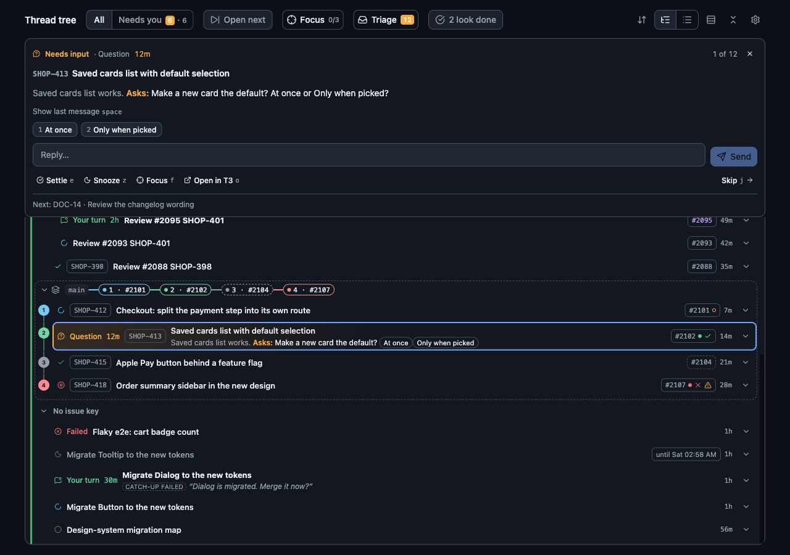
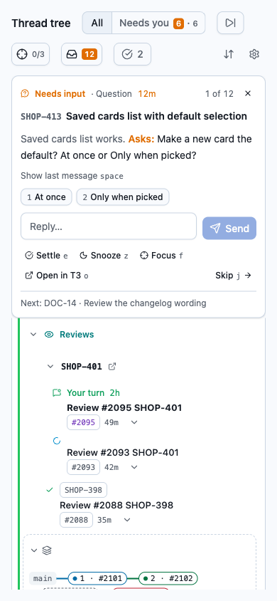
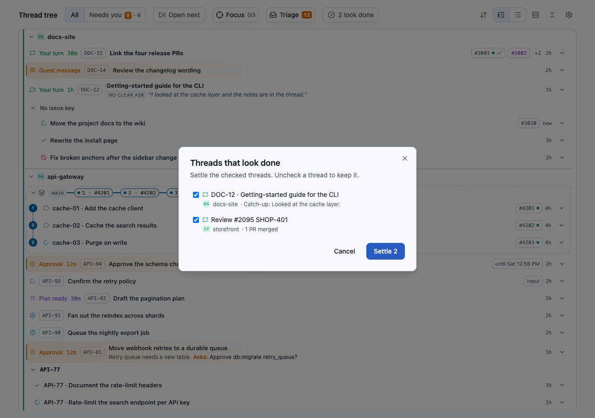
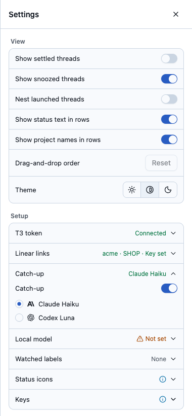

<p align="center"></p>

# T3 thread tree

A live map of your [T3 Code](https://github.com/pingdotgg/t3code) threads.

T3 Code shows threads as a flat list. When agents launch threads, review PRs and work through PR stacks, a flat list does not show how the work fits together. This app shows the active threads as one tree, **Project › issue key › thread**, with a status and PR marks on each row. Click a thread to open it in T3 Code.

Use it as a Mac app or in a browser. The Mac app adds a Dock badge, notifications, a menu-bar entry and a small Up next window.


_Screenshots use made-up data from `bun run demo`._

## What you get

### See your work

- **One tree for all projects.** Threads group by project, then by the first issue key in the title. Review threads go in a Reviews group at the top. Each project has the same icon and color as in T3 Code.
- **Status at a glance.** Each row starts with a status icon. Rows that wait for you show the wait time and a phrase, such as "Approval" or "Your turn". The Settings panel has a legend. Color is never the only sign.
- **PR marks and stacks.** Each row shows its PRs with checks, review, conflicts, draft, merged and closed marks. Threads in one PR stack sit in one block, with a line of numbered stops from the base branch to the top PR.
- **Launch lineage.** The details of a launched thread link to the thread that launched it. Turn on "Nest launched threads" to show it under that thread.
- **Flat view and grouping.** Switch between Tree and Flat. Group by T3 project, Linear project (with milestones), or status. Sort by your own order (drag the rows) or by last updated.
- **Details on demand.** The chevron at the end of a row shows the request, error, last message, model, branch, worktree, goal and all PRs.
- **Live.** Changes arrive as T3 streams them. No polling, no reload. The page remembers your folds, filter, layout and theme.

### Know what needs you

- **Catch-up line.** When the Catch-up is on, a row that waits for you or failed shows a line under its title: what the thread did and what it asks, with the options as chips. A thread with no clear ask shows its last question.
- **Needs you.** The "Needs you" filter keeps only the threads that wait for you, with a count. The browser tab title and the Dock badge show the same count.
- **Open next.** The "Open next" button, or the key `n`, opens the thread that has waited longest. Press it again for the next one.
- **Focus list.** Pin up to three threads to a strip above the tree. The keys `1` to `3` open them.
- **Find.** Cmd+K (Ctrl+K off macOS) searches all threads by title, issue key, project, branch or PR number.

### Act on threads

- **Triage mode.** The "Triage" button, or the key `t`, shows one card at a time for the threads that wait for you, longest wait first. The card shows the Catch-up. Reply in the field or with a chip, or use Settle, Snooze, Focus, Open in T3 or Skip. Each action has a key.

  

  

- **Looks done.** The "N look done" button shows when threads look finished: no recent run, and all PRs merged or closed, or a Catch-up that says it is done. It opens a list with a checkbox for each thread and the reason. "Settle N" settles the checked threads. A toast lets you undo for 10 seconds.

  

- **Settle and send from a row.** The icons at the end of a row settle the thread in one click, or open a dialog to send it a message. Settled threads show on demand in a list below the tree.
- **Keys.** `j`/`k` move between rows, Enter opens, `o` opens the details, `s` opens Send. The "Keys" fold in Settings lists all keys.

### Mac app

- **Dock badge and notifications.** The Dock icon shows the Needs-you count. You get a notification when a thread starts to need you or fails. With the Catch-up on, the notification shows what the thread asks and what it did. "Mute Notifications" in the app menu turns them off.
- **Menu-bar entry.** The menu-bar icon shows the Needs-you count. Its menu starts with "Open next" and lists the waiting threads, each with its Catch-up.
- **Up next window.** A small window that stays on top lists the threads that wait for you, each with its Catch-up. Press ⌥⌘U to show or hide it, also from another app.
- **Updates.** The app checks GitHub Releases. When a new version exists, the menus and Settings offer "Update and restart".

### Settings

The cog opens the Settings panel. Each setup fold shows its state, and each field tells you what to type.



- **View.** Show settled or snoozed threads, nest launched threads, status text, project names, reset the order, and the theme.
- **T3 token.** Paste the token. The app reconnects with no restart.
- **Linear links.** Your Linear workspace and teams, so issue keys link to Linear. A Linear API key adds project and milestone grouping.
- **Catch-up.** A switch turns the Catch-up on or off. Pick the model that runs it: Claude Haiku or Codex Luna (when the `claude` or `codex` CLI is logged in), the Apple model (in the desktop app, on a Mac with Apple Intelligence on), or your Local model. The Apple model and the Local model keep thread text on your Mac.
- **Local model.** The base URL and name of a model on this machine, for example with Ollama.
- **Watched labels.** PR label names to show as pills on rows.

[SPEC.md](SPEC.md) gives the full rules for each feature.

## Requirements

- [Bun](https://bun.sh) 1.3 or later
- T3 Code running on the same machine (the app reads `~/.t3/userdata`)
- Optional, for the desktop app: macOS on Apple Silicon
- Optional, for the Catch-up: the `claude` or `codex` CLI, logged in
- Optional, for the Catch-up on a local model: the Ollama app build (`brew install --cask ollama-app`)
- Optional, for the Catch-up on the Apple model: the desktop app on macOS 26.4 or later, with Apple Intelligence on. To build the desktop app from source, Command Line Tools with the macOS 26.4 SDK or later

## Setup

```sh
bun install
```

Start the app, click the cog to open the Settings panel, and paste a T3 token in the "T3 token" field. The panel shows the command that issues one. The token needs the `orchestration:read` and `orchestration:operate` scopes. With a read-only token the tree works, but Settle fails. The app keeps the token in `~/.config/t3-thread-tree/token`, and the desktop app in `~/Library/Application Support/T3 Thread Tree/token`. A `T3_TOKEN` in `.env` works as the fallback.

Optional: link Linear issue keys. Set them in Settings, or add these to `.env`. The Settings value wins.

```sh
LINEAR_WORKSPACE=join-com   # the slug in linear.app/<workspace>
LINEAR_TEAMS=JED,ENG,MOR    # optional: link only the keys of these teams
```

To group by Linear project and milestone, make a personal API key at `linear.app/settings/account/security` and paste it in the "Linear links" fold. A `LINEAR_API_KEY` in `.env` works as the fallback.

Optional: run the Catch-up on a local model. Install the Ollama app build with `brew install --cask ollama-app` (the Homebrew formula cannot return structured output). Pull a model, for example `ollama pull qwen3.5:4b-nvfp4`, and start Ollama. In the "Local model" fold, type the base URL (`http://localhost:11434/v1`) and the model name, and save. apfel (`brew install apfel`) also works here: base URL `http://localhost:11434/v1`, model `apple-foundationmodel`.

Optional: set the path of the `t3` CLI, which the app runs to send messages. The default is `~/.t3/bin/t3`:

```sh
T3_BIN=/path/to/t3
```

### Install

Choose one path.

- **`.dmg`:** download the `.dmg` from GitHub Releases and drag the app to `/Applications`. The app has an ad-hoc signature, not a Developer ID. At the first open, macOS blocks it. Open System Settings › Privacy & Security and click "Open Anyway". Or run this command:

  ```sh
  xattr -dr com.apple.quarantine "/Applications/T3 Thread Tree.app"
  ```

- **From source:** run `bun run desktop:install`. It builds and signs the app and copies it to `/Applications/T3 Thread Tree.app`. Quit the app first, because the command replaces it. Run `bun run desktop:dmg` to write the `.dmg` to `release/` instead.
- **Browser:** run `bun start`. See [Run](#run).

## Run

```sh
bun start
```

Open <http://127.0.0.1:4773>. The app starts even when T3 is not running. Until T3 is back, the page shows the last tree, greyed.

To use the desktop window from source, run `bun run desktop`. Run `bun run desktop:demo` to see the demo in the window.

To see the UI without T3, run `bun run demo` and open <http://127.0.0.1:4774>. Set `CLIS=0` to offer no CLI model, `PUSH=1` to fake a live change every 3 seconds, `SEND=failed` to make a send fail, and `T3CLI=0` to show the `t3` CLI as missing.

## How it works

```
T3 Code ──WebSocket (orchestration.subscribeShell)──▶ Bun server ──SSE (/events)──▶ React page
statev2.sqlite (read-only) ──launch lineage──────────▶
```

- `src/server/t3.ts` holds the T3 stream: a small Effect RPC client and a lenient decoder. T3's protocol is internal, so all protocol code stays in this one module.
- `src/server/lineage.ts` reads `statev2.sqlite`, read-only, for launch lineage and the last message of each thread.
- `src/server/model.ts` runs every model call, such as the Catch-up.
- `src/server/build-tree.ts` applies the tree rules. It is a pure function, and `bun test` covers it.
- `src/server.ts` builds the tree again on each change and pushes it over Server-Sent Events.
- `src/page/` is a React, Tailwind and shadcn page, bundled by Bun's HTML imports. There is no Vite and no build step.
- `src/shared/` holds the types and logic that the server and the page share.
- [SPEC.md](SPEC.md) defines the rules, [DESIGN-SPEC.md](DESIGN-SPEC.md) the visual design, and [CONTEXT.md](CONTEXT.md) the terms.

The app writes to T3 in two ways. A send runs the `t3` CLI. Settle, unsettle and snooze go over the stream, with the `orchestration:operate` scope of the token.

The desktop app is Electron. `src/desktop/main.ts` starts the compiled server as a child process and loads the page in the window. electron-builder packages and signs the app ad-hoc.

## Develop

```sh
bun test                 # unit tests
bun run typecheck        # types
bun run lint             # oxlint
bun run fmt              # oxfmt, writes fixes
bun run check            # all of the above, as CI runs it
bun run build:sidecar    # compiles the server (macOS arm64)
bun run build:apple-helper  # compiles the Apple model helper (macOS 26.4 SDK)
bun run desktop:install  # builds and installs the app in /Applications
bun run desktop:dmg      # builds the .dmg in release/
bun run release          # builds the .dmg and .zip and creates the GitHub release
```

CI runs `bun run check` and `bun run build:sidecar` on every pull request. A pull request merges only when it passes.
